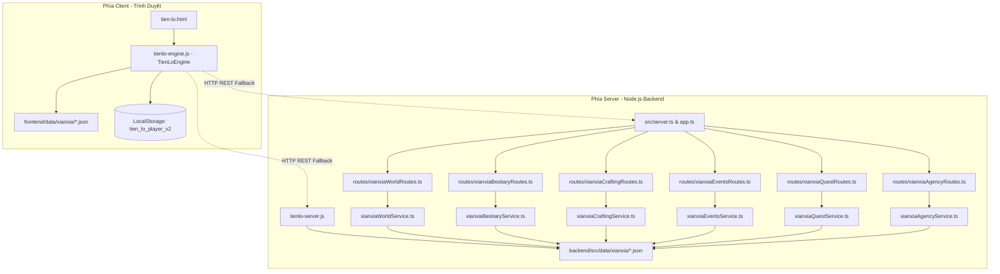

# BÁO CÁO AUDIT KIẾN TRÚC & HỆ THỐNG GAMEPLAY
## DỰ ÁN: TIÊN LỘ: VẠN GIỚI TRANH PHONG (KỲ BIẾN PLATFORM)

**Người thực hiện:** Senior Game Systems Architect, Gameplay Engineer & QA Lead  
**Ngày thực hiện:** 24/10/2026  
**Phạm vi:** Mục 1 — Thống Nhất Gameplay Tổng Thể  
**Trạng thái:** Giai đoạn A — Khảo sát, Truy vết và Phân tích (Chưa can thiệp mã nguồn)

---

## I. TỔNG QUAN KHẢO SÁT DỰ ÁN (BƯỚC A1)

### 1. Thư mục gốc và Ngăn xếp Công nghệ (Tech Stack)
- **Thư mục dự án:** `D:\Lap trinh game\ky_bien`
- **Ngôn ngữ & Nền tảng:**
  - **Backend:** Node.js v20+, TypeScript (ESM, target ES2022), Express 4.19, Socket.io 4.7, Prisma ORM 5.10 (PostgreSQL).
  - **Frontend:** HTML5, CSS3 hiện đại (CSS Variables, Flexbox, Grid), Vanilla JavaScript (ES6+ Classes), zero build tool (mở trực tiếp hoặc qua static server).
- **Entry Points:**
  - `backend/src/server.ts`: Cổng khởi chạy hệ thống toàn diện Kỳ Biến (Cờ tướng, Puzzle, Xianxia, Socket, Cron jobs).
  - `backend/tienlo-server.js`: Cổng máy chủ độc lập (Standalone CJS Server, cổng 3009) phục vụ riêng game Tiên Lộ với 6 REST router tĩnh.
  - `frontend/tien-lo.html`: Trang giao diện người dùng chính của game Tiên Lộ.
  - `frontend/tienlo-engine.js`: Bộ điều khiển logic chính phía client (lớp `TienLoEngine`).

---

### 2. Bản đồ Phân hệ Hiện có



### 3. Hiện trạng Nguồn Sự Thật (Source of Truth) & Dữ liệu Trùng lặp
1. **Dữ liệu JSON tĩnh bị phân mảnh hai nơi:**
   - Thư mục backend: `backend/src/data/xianxia/` (9 tệp).
   - Thư mục frontend: `frontend/data/xianxia/` (9 tệp).
   - **Bằng chứng sai lệch:** Qua kiểm tra hash nhị phân, tệp `items.json` tại `frontend/data/xianxia/items.json` (7.480 bytes) chứa trang bị mới `item_thanh_tam_boi` (Thanh Tâm Ngọc Bội), nhưng tại `backend/src/data/xianxia/items.json` (6.923 bytes) lại chưa có vật phẩm này.
2. **Trạng thái Người chơi (Player State Persistence):**
   - Phía Client: Lưu toàn bộ chỉ số vào `localStorage.getItem('tien_lo_player_v2')`.
   - Phía Backend: Cơ sở dữ liệu Prisma (`backend/prisma/schema.prisma`) **hoàn toàn chưa có bảng dữ liệu nào dành cho Tiên Lộ** (chỉ có `User`, `Match`, `Puzzle`). Các service backend (`xianxiaQuestService`, `xianxiaAgencyService`) lưu trạng thái người chơi trong bộ nhớ RAM tạm thời (`Map<userId, PlayerQuestProgress>`). Khi máy chủ khởi động lại, toàn bộ tiến trình này bị mất.

---

## II. TRUY VẾT CÁC LUỒNG GAMEPLAY (BƯỚC A2)

### 1. Luồng Khởi tạo & Lưu trữ Trạng thái Nhân vật
- **Điểm bắt đầu:** `TienLoEngine.loadPlayerState()` (`frontend/tienlo-engine.js:199-216`).
- **Luồng dữ liệu:**
  1. Kiểm tra `localStorage.getItem('tien_lo_player_v2')`. Nếu chưa có $\rightarrow$ gọi `getDefaultPlayer()` (`dòng 154-197`).
  2. Khởi tạo đối tượng nhân vật:
     ```js
     {
       character_created: false,
       name: 'Vô Danh Tu Sĩ',
       title: 'Tán Tu Sơ Nhập Đạo',
       realm: 'PHAM_NHAN',
       health: 120, max_health: 120,
       fatigue: 100, max_fatigue: 100,
       cultivation: 0, cultivation_required: 120,
       stat_points: 0,
       physique: 12, comprehension: 14, luck: 12, karma: 0,
       silver: 150,
       equipment: { weapon: null, armor: null, relic: null },
       inventory: [...],
       quest_progress: {}
     }
     ```
  3. Nếu `character_created === false`, mở modal `character-creation-modal` cho phép chọn Linh Căn & Xuất Thân.
  4. Người chơi ấn "Bắt Đầu Vấn Đạo" $\rightarrow$ `confirmCharacterCreation()` (`dòng 388-435`) gán bonus điểm chỉ số và lưu lại bằng `savePlayerState()`.
- **Đánh giá:** Luồng khởi tạo hoạt động tốt ở client, nhưng hoàn toàn cô lập với hệ thống tài khoản (`User`) của backend.

---

### 2. Luồng Chiến Đấu (Combat) & Cơ Chế Hành Động
- **Điểm bắt đầu:** Người chơi ấn nút *"Khiêu Chiến"* tại Dị Thú $\rightarrow$ gọi `startBattle(monsterId)` (`frontend/tienlo-engine.js:853-889`).
- **Hiện trạng:**
  - Khởi tạo object `this.battle`:
    ```js
    this.battle = {
      monster, monster_hp, monster_max_hp,
      player_qi: 25, player_max_qi: 50,
      turn: 1, guarding: false,
      intent: this.rollMonsterIntent(mon),
      weaponAtk, armorDef, relicPwr, logs: []
    };
    ```
  - Mở `#battle-modal`. Quái vật báo trước `intent` (`ATTACK`, `HEAVY`, `CHARGE`).
  - **Cơ chế hiện tại là Theo Lượt Từng Nước (Turn-based Interactive):**
    - Người chơi bắt buộc phải click 1 trong 4 nút: `STRIKE`, `SKILL`, `GUARD`, `FLEE` qua hàm `playerBattleAction(action)` (`dòng 954-1035`).
    - Sau khi người chơi ra lệnh, quái vật mới phản kích theo `intent`.
- **Bằng chứng mâu thuẫn với định hướng đã duyệt:**
  - Định hướng của chủ dự án: *"Chiến đấu: Tự động hoàn toàn. Người chơi không phải chọn STRIKE, SKILL, GUARD hoặc FLEE trong từng lượt. Thể loại: Idle RPG tu tiên kết hợp cốt truyện và tự do thám hiểm."*
  - Hiện tại người chơi phải dừng lại thao tác thủ công từng hiệp, gây gián đoạn luồng thám hiểm và không thể tích hợp vào cơ chế Idle / Treo máy tự động.

---

### 3. Luồng Phân Phối Phần Thưởng (EXP vs Tu Vi)
- **Điểm bắt đầu:** Khi quái vật hết máu (`monster_hp <= 0`) $\rightarrow$ `endBattle('WIN')` (`frontend/tienlo-engine.js:1037-1082`).
- **Bằng chứng lỗi nghiêm trọng (Exp Black Hole):**
  - Tại dòng 1047-1049:
    ```js
    const expGained = mon.exp_reward || 50;
    const cultGained = mon.cultivation_reward || 20;
    const silverGained = Math.floor(mon.silver_reward * (0.8 + Math.random() * 0.4)) || 30;

    this.player.silver += silverGained;
    this.addCultivation(cultGained);
    // BIẾN expGained HOÀN TOÀN BỊ BỎ RƠI, KHÔNG HỀ ĐƯỢC LƯU TRỮ HAY SỬ DỤNG!
    ```
  - Trong `this.player`, hoàn toàn không có thuộc tính `exp` hay `level`!
  - Trong khi đó, tại backend:
    - `xianxiaQuestService.ts:129`:
      ```typescript
      const levelMet = !quest.requirements.min_level || playerContext.level >= quest.requirements.min_level;
      ```
    - File dữ liệu `quests.json` quy định:
      ```json
      "requirements": { "min_realm": "PHAM_NHAN", "min_level": 1 }
      ```
    - Người chơi không có `level`, nên `playerContext.level` truyền từ frontend bị `undefined` hoặc bằng 0.
- **Kết luận:** Hệ thống có sự lẫn lộn giữa hai khái niệm: Cấp độ nhân vật (Character Level/EXP) và Cảnh giới tu chân (Realm Tier/Tu vi Cultivation).

---

### 4. Luồng Tu Luyện, Cảnh Giới & Đột Phá
- **Cơ chế đả tọa (`meditateRest`):**
  - Đã được vá: cooldown 30s (`last_meditate`), tốn 5 Bạc nếu ở ngoài động phủ, hồi 35 Thể lực và 25 HP.
  - Đã loại bỏ hoàn toàn việc cộng tu vi vô hạn tại đây.
- **Cơ chế tu luyện treo máy (`tickIdleCultivation`):**
  - Tích lũy tu vi tự động theo thời gian thực dựa trên Ngộ tính và Linh căn vào `player.idle_cultivation_bank`.
  - Người chơi bấm "Thu Hoạch Tu Vi Nhập Định" để cộng vào `player.cultivation`.
- **Cơ chế đột phá (`openBreakthroughModal` & `executeBreakthrough`):**
  - Khi `player.cultivation >= player.cultivation_required`, người chơi chủ động bấm nút "Xung Quan Đột Phá".
  - Có tỷ lệ rủi ro thất bại (trừ 30% tu vi, trừ 25% HP), có thể dùng đan dược hỗ trợ (Dưỡng Khí Đan +15%, Trúc Cơ Đan +35% & bảo vệ kinh mạch).
  - Thành công: Nhận +4 Điểm Tiềm Năng (`stat_points`).
- **Điểm yếu kiến trúc:**
  - Cảnh giới chỉ đơn thuần tăng các chỉ số tĩnh (`max_health`, `max_fatigue`, `physique`, `comprehension`).
  - Chưa mở khóa thêm công pháp mới, chưa mở khóa thêm cơ chế chiến đấu mới hay mở rộng các slot trang bị/bí cảnh riêng biệt tương ứng cảnh giới.

---

### 5. Luồng Chế Tạo (Crafting), Thu Thập (Gathering) & Kinh Tế
- **Thu thập (`gatherAtNode`):** Tốn thể lực $\rightarrow$ nhận nguyên liệu thảo mộc / khoáng thạch $\rightarrow$ cộng tu vi.
- **Chế tạo (`craftRecipe`):** Kiểm tra nguyên liệu trong túi $\rightarrow$ trừ nguyên liệu $\rightarrow$ tỷ lệ thành công (thất bại ra Phế Đan, thành công ra đan dược hoặc trang bị).
- **Cửa hàng (`openShopModal`):** Cho phép mua đan dược/vũ khí bằng Bạc và bán vật phẩm trong túi lấy 50% giá Bạc.
- **Điểm yếu gameplay:**
  - Vòng tuần hoàn tài nguyên chưa khép kín: Người chơi dư thừa Bạc rất nhanh nhưng không có nơi tiêu thụ có chiều sâu (Item Sink).
  - Đan dược chủ yếu là hồi máu và tăng tu vi trực tiếp, chưa có đan dược buff chỉ số chiến đấu tạm thời, đan dược giải độc, hay đan dược biến đổi căn cốt.

---

### 6. Luồng Nhiệm Vụ (Quests) & Tiêu Cục (Agency)
- **Nhiệm vụ tu chân:** 13 nhiệm vụ (3 chính tuyến, 10 cày cuốc).
  - Có theo dõi tiến độ giết quái (`notifyMonsterKill`), nhặt đồ (`notifyLootAcquired`).
  - Lưu trạng thái vào `player.quest_progress[questId]`.
- **Tiêu cục giang hồ:** 15 nhiệm vụ thám hiểm (Áp tiêu, Phi tiêu, Thảo phạt, Quân nhu, Kỳ ngộ).
- **Điểm yếu gameplay:**
  - Nhiệm vụ tồn tại độc lập như một danh sách "cần làm" (to-do list), chưa đóng vai trò dẫn dắt người chơi thâm nhập vào các bí cảnh hay thúc đẩy mở khóa vòng lặp tiến hóa.

---

## III. PHÂN LOẠI CÁC PHÁT HIỆN

### 1. Lỗi Đã Xác Minh (Verified Bugs)
| Mã | Phát hiện | Tệp & Dòng | Bằng chứng | Mức độ |
|---|---|---|---|---|
| **BUG-01** | **EXP Black Hole:** Biến `expGained` bị bỏ rơi hoàn toàn khi thắng trận, nhân vật không có EXP/Level. | `frontend/tienlo-engine.js:1047-1052` | `const expGained = mon.exp_reward;` được khai báo nhưng không có hàm nào cộng vào người chơi. `this.player` không có trường `exp` hay `level`. | **Nghiêm trọng** |
| **BUG-02** | **Xung đột điều kiện Quest Level:** Backend kiểm tra `playerContext.level`, nhưng Client không cung cấp `level`. | `backend/src/services/xianxia/xianxiaQuestService.ts:129` | `playerContext.level >= quest.requirements.min_level` luôn thất bại hoặc nhận `undefined`. | **Cao** |
| **BUG-03** | **Lệch pha dữ liệu Items:** `items.json` ở backend thiếu vật phẩm `item_thanh_tam_boi`. | `backend/src/data/xianxia/items.json` so với `frontend/data/xianxia/items.json` | Hash nhị phân và Git diff xác nhận backend thiếu `item_thanh_tam_boi`. Khi client gọi API liên quan item này, backend sẽ báo lỗi không tìm thấy. | **Trung bình** |
| **BUG-04** | **Backend State Volatility:** Trạng thái quest và agency trên server lưu trong RAM (`Map`), mất sạch khi reboot. | `backend/src/services/xianxia/xianxiaQuestService.ts:37` & `xianxiaAgencyService.ts:31` | Không có kết nối tới Prisma Client hay Database, chỉ lưu trong `new Map()`. | **Cao (Multiplayer)** |

---

### 2. Điểm Thiết Kế Yếu Có Bằng Chứng (Design Flaws)
| Mã | Vấn đề | Bằng chứng mã nguồn | Tác động gameplay |
|---|---|---|---|
| **DSG-01** | **Chiến đấu theo lượt thủ công mâu thuẫn với định hướng Idle RPG.** | `frontend/tienlo-engine.js:954-1035` (`playerBattleAction`) | Người chơi phải click tay 4 nút từng hiệp. Phá vỡ trải nghiệm rảnh tay (Idle) và thám hiểm tự do. |
| **DSG-02** | **EXP và Tu Vi chưa có ranh giới chức năng rõ ràng.** | Cả frontend lẫn backend đều thưởng cả hai cùng lúc từ quái/quest, nhưng người chơi chỉ dùng Tu vi để lên cảnh giới. | Người chơi không hiểu EXP dùng làm gì và Tu vi dùng làm gì. |
| **DSG-03** | **Client-Authoritative Combat & Loot:** Kết quả trận đấu do Client tự tính toán và tự thưởng. | `frontend/tienlo-engine.js:1037-1070` | Người chơi có thể can thiệp localStorage hoặc sửa code JS để chiến thắng mọi quái vật và tự cộng đồ. Không thể triển khai PvP/Multiplayer công bằng. |
| **DSG-04** | **Phần thưởng chiến lợi phẩm đơn điệu, thiếu chiều sâu xây dựng nhân vật (Builds).** | `monsters.json` & `items.json` | Rơi đồ chủ yếu là nguyên liệu thô và vài loại trang bị tĩnh. Không có công pháp (kỹ năng kích hoạt/bị động), không có hiệu ứng trang bị đặc sắc. |
| **DSG-05** | **Vòng lặp tiêu thụ tài nguyên (Resource Sinks) lỏng lẻo.** | `frontend/tienlo-engine.js:1100-1170` | Bạc và Linh thảo tích lũy nhanh chóng nhưng không có các mục tiêu lớn để tiêu hao (như nâng cấp Động phủ, đột phá công pháp, khảm nạm bảo thạch). |

---

### 3. Rủi Ro Cần Kiểm Tra Thêm (Risks to Verify)
- **RSK-01:** Khi chuyển sang chiến đấu tự động hoàn toàn (Full Auto-Combat), các bài kiểm thử cũ (`xianxiaBestiary.test.ts`, `xianxiaFrontendIntegration.test.ts`) có thể bị ảnh hưởng nếu các hàm wrapper không được bảo toàn.
- **RSK-02:** Việc đồng bộ trạng thái nhân vật giữa LocalStorage (đang dùng cho client offline) và PostgreSQL Prisma (cho multiplayer sau này) đòi hỏi cơ chế đồng bộ hai chiều (Bi-directional Synchronization) với giải quyết xung đột (Conflict Resolution).

---

## IV. ĐÁNH GIÁ MỨC ĐỘ THỐNG NHẤT GAMEPLAY (10 CÂU HỎI CỐT LÕI - BƯỚC A3)

| STT | Câu hỏi đánh giá | Đánh giá thực tế | Bằng chứng & Đề xuất khắc phục |
|:---:|---|:---:|---|
| **1** | Người chơi có biết mục tiêu tiếp theo là gì không? | **Khá** | Đã có widget *Thiên Cơ Chỉ Dẫn* gợi ý việc nên làm, nhưng các mục tiêu dài hạn (vượt cảnh giới lớn, học công pháp tối thượng) chưa được thể hiện rõ trên lộ trình. |
| **2** | Hoạt động cày cuốc có gắn với nhu cầu phát triển cụ thể không? | **Trung bình** | Cày cuốc quái hiện tại chủ yếu để lấy bạc và tu vi. Chưa tạo ra động lực bức thiết như: "Cần da sói ngàn năm để rèn giáp kháng độc mới đi qua được đầm lầy bí cảnh". |
| **3** | EXP và Tu Vi có phân biệt rõ chức năng không? | **Kém (Lỗi)** | EXP bị vứt bỏ hoàn toàn trong code client (`BUG-01`). Cần định nghĩa rõ: EXP dùng để tăng Cấp Thể Chất/Kỹ Năng; Tu Vi dùng để ngưng tụ Chân Nguyên và Xung Quan Cảnh Giới. |
| **4** | Chiến đấu có tự động hoàn toàn hay vẫn phụ thuộc thao tác từng lượt? | **Kém (Sai định hướng)** | Vẫn đang là chiến đấu theo lượt người chơi phải bấm nút chọn từng hiệp (`DSG-01`). Cần chuyển thành Auto-Combat tính toán dựa trên chỉ số, tốc độ và công pháp. |
| **5** | Chiến lợi phẩm có dẫn đến các quyết định phát triển hữu ích không? | **Trung bình** | Vật phẩm rơi ra chủ yếu đem bán hoặc nấu thuốc hồi máu cơ bản. Chưa kích hoạt các lựa chọn hướng đi (Builds) của nhân vật. |
| **6** | Cốt truyện và thám hiểm có sử dụng chung trạng thái gameplay không? | **Tốt** | Hệ thống nhiệm vụ đã liên kết với phân khu địa lý, NPC và việc trảm yêu thực tế. |
| **7** | Cảnh giới có tạo ra năng lực, nội dung hoặc lựa chọn mới không? | **Trung bình** | Cảnh giới mới chỉ tăng chỉ số máu/thể chất/điểm tiềm năng. Cần mở khóa thêm: Ô trang bị mới, Tầng công pháp mới, và Bí cảnh hạn định cảnh giới. |
| **8** | Hoạt động offline có nhất quán với hoạt động online không? | **Tốt** | Đã có cơ chế tích lũy tu vi treo máy theo giây (tối đa 8 giờ) dựa trên Ngộ tính và Linh căn. |
| **9** | Các hệ thống có sử dụng cùng nguồn dữ liệu và quy tắc tính toán không? | **Trung bình** | Frontend và Backend đang sở hữu 2 bản JSON độc lập dẫn đến lệch pha (`BUG-03`). |
| **10** | Có rủi ro nhân đôi phần thưởng, mất dữ liệu hoặc không nhất quán không? | **Cao** | Trạng thái lưu hoàn toàn ở client LocalStorage, backend chỉ giữ in-memory Map (`BUG-04`), chưa thể chống gian lận trong môi trường multiplayer. |

---

## V. KẾT LUẬN AUDIT
Hệ thống hiện tại đã có bộ khung dữ liệu rất phong phú (3 phân khu, 5 NPC, 5 quái, 17 vật phẩm, 6 kỳ ngộ, 13 nhiệm vụ, 15 tiêu vụ). Tuy nhiên, **gameplay đang bị đứt gãy ở 3 điểm mấu chốt**:
1. **Chiến đấu chưa tự động hoàn toàn** theo đúng thể loại Idle RPG.
2. **Khái niệm EXP và Tu Vi bị lẫn lộn**, EXP bị rơi vào "hư không", không đóng góp vào tiến trình nhân vật.
3. **Mô hình kiến trúc còn phụ thuộc tuyệt đối vào client LocalStorage**, backend chỉ đóng vai trò thứ yếu và thiếu tính nhất quán cho mục tiêu multiplayer.
